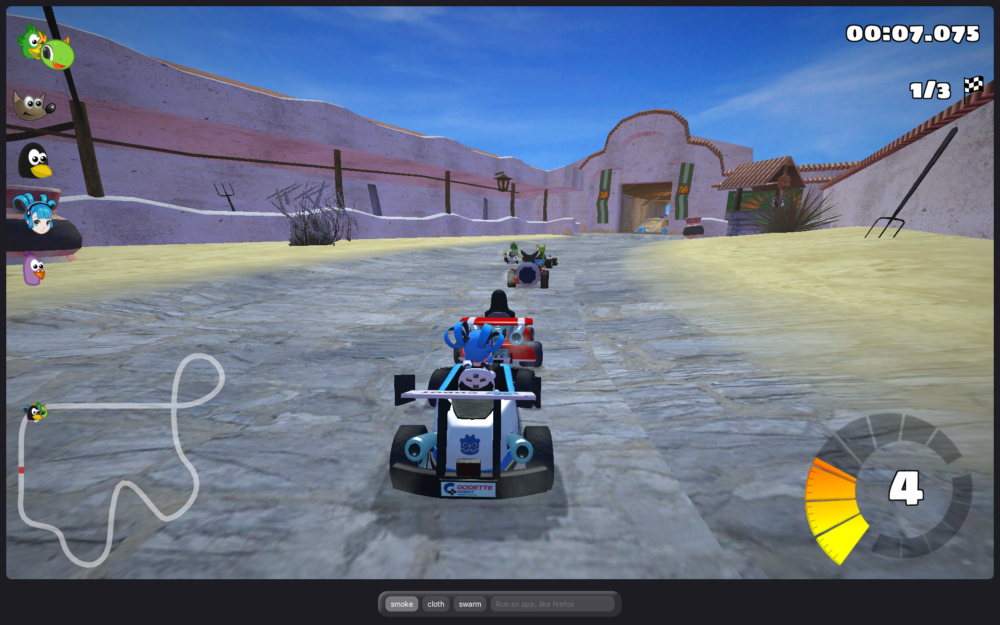
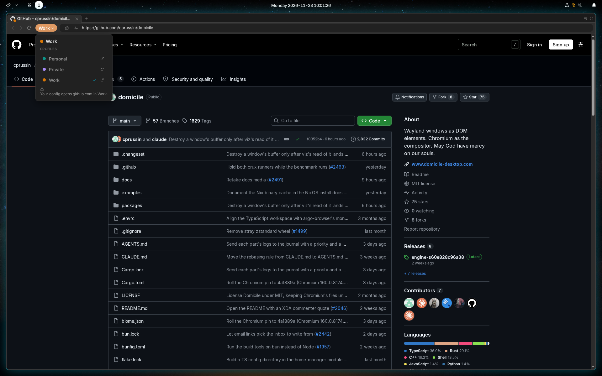
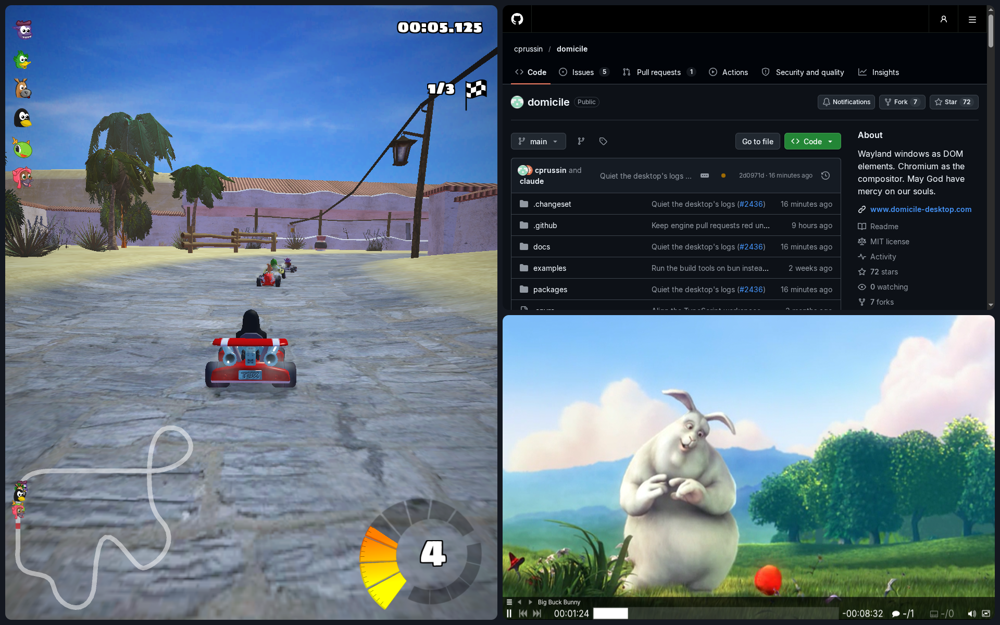

# Release notes

What's new for shells and apps built on Domicile, in each release. What's new
in the manganese desktop is in
[manganese's release notes](use/RELEASE-NOTES.md).

## 1.4.0

_Unreleased_

### Shader effects

Your shell can draw its own SkSL over any element. Register it with `domicile.effects.register(name, { sksl, outset })`, then use it with `filter: domicile-shader(name, …)` or `backdrop-filter`. Its numbers animate with CSS transitions, and it composes with the built-in filters. When the GPU hangs on an effect, the engine drops it and `effects.on("lost")` names it.

An effect can draw the element through a mesh, a grid for cloth or instances for particles, placed by its own `vertex` program. It samples `images`, takes arrays you set for each element with `update(element, { points })`, and with `outset: "screen"` draws as far as the screen. A closed window's last frame stays while its `<app>` is in the page, up to 10 seconds, so a close effect plays on it. Windows say where they came from, so an open can start there: `launchedFrom` for a launch, `opener` for a browser window a page opened.

[Shader effects](SHELL-SHADER-EFFECTS.md) is the guide, and [`shell-effects-example`](/packages/shell-effects-example) builds smoke, cloth, swarm, liquid glass and a workspace cube with it. The effect types are in `@domicile-desktop/sdk/desktop/effects`.

[Design](architecture/MOTION.md#shader-primitive)

### Panda CSS 2

The component library's preset and manganese's Panda config are built for Panda CSS 2. A shell that runs Panda with either needs `@pandacss/dev@2`. `@domicile-desktop/manganese/css` and its other generated entry points are `index.js` files, as Panda 2 writes them.

[Shell packaging](SHELL-PACKAGING.md#panda-with-manganeses-tokens)

### Agents get shorter answers from browser windows

The MCP server's `browser_snapshot` leaves out the `InlineTextBox` lines that repeat a text's words, and stops at 1500 elements with a line saying so. An act answers with at most 100 lines of what changed, then says how much more there is. `list_windows` gives a browser window an agent holds its seat in `held_by`, as it does a native window.

[Agents](AGENTS.md)

### Agents' own pointer and keyboard reach browser windows

An agent seat's `click`, `move_pointer`, `drag`, `scroll`, `key`, `type_text` and `focus_window` now reach browser windows at desk positions, not only native windows, so an agent can draw on a canvas or drag from one page to another. The compositor sends each step to the browser as `agent_input` on the control channel; the browser hit tests the desk point to the page under it and answers `agent_input_reached` with the window it reached or why it refused. A point on the shell's own page is refused: agents act on the shell by ref. The user's own press or key in a browser window an agent holds takes it (`person_in_agents_window`), and `domicile.seats.list` names browser windows in `holds` and `taken` by their ids.

[Agents](AGENTS.md) · [Agent seats](architecture/AGENT-SEATS.md#browser-windows-at-desk-positions)

### An agent's input to a browser window leaves the user's focus

DevTools input sent to a browser window's own page, as `domicile devtools <window>` and the MCP server's `browser_` tools send it, no longer moves the user's focus to that window: a press focuses the page for the agent only, and `Input.insertText` and keys go to the frame focused in that page rather than wherever the user is typing. Input sent to window `shell` still focuses what it presses, as a person's click does. `browser_click` also clicks at a point of the page, with any button and as a double-click, and `browser_drag` and `browser_scroll` drag and scroll there, for a canvas or anything else with no ref.

[Agents](AGENTS.md) · [Agent seats](architecture/AGENT-SEATS.md#what-each-kind-of-window-gets)

### Windows an agent starts are held by it

`domicile exec --agent <session>` and `domicile open --agent <session>` start a program for an agent session: its windows, and those of programs it starts, open held by the agent's seat with the agent's keyboard in them. They get no activation token, and `heldBy` is set when the shell first hears of the window, so a shell can open it without focusing it. The MCP server's `exec` and `open` use them.

[Agent seats](architecture/AGENT-SEATS.md#taking-over) · [`domicile exec`](CLI.md#domicile-exec---agent-session-program-arg)

### Shells see agents' seats

`domicile.seats.list` lists the agent seats: each agent's name, where its pointer is, the window its keyboard is in, the windows it holds and the windows the user took from it. Each window's `heldBy` names the agent seat holding it. `domicile.seats.takeOver(appId)` takes a window from an agent, as the user's click or key in it does, and the agent can't drive it until `domicile.seats.giveBack(appId)`. A window the user takes stays theirs after they leave it. `useSeats()` in `@domicile-desktop/react/seats` follows the list. `domicile list-windows` and the MCP server's `list_windows` add `held_by`.

[Writing a shell](WRITING-A-SHELL.md#agents-beside-the-user) · [Agent seats](architecture/AGENT-SEATS.md#shell-primitives) · [`domicile list-windows`](CLI.md#domicile-list-windows---json)

### Agents copy and paste on a clipboard of their own

An agent session's seat has its own clipboard and middle-click selection. An app the agent types in copies to and pastes from the agent's, so an agent's copy never replaces the user's, and clipboard managers and the clipboard history see only the user's. The agent's go when its session ends.

[Agents](AGENTS.md) · [Agent seats](architecture/AGENT-SEATS.md#clipboard)

### Agents get their own pointer and keyboard

Each agent session has a seat of its own, so an agent clicks and types in one native window while the user works in another, and never moves the user's pointer or focus. `domicile pointer`, `drag`, `scroll`, `key`, `type` and `focus-window` take `--agent <session>`, and `domicile agent` prints the session. One seat drives an app at a time, and the user wins an app both want. Shell commands still wait until the user has been away for 30 seconds: `domicile idle-time --json` adds `local_seconds`, which counts only the computer's own keyboard, pointer and touch.

[Agents](AGENTS.md) · [Agent seats](architecture/AGENT-SEATS.md) · [`domicile pointer`](CLI.md#domicile-pointer---agent-session-xy-clickdouble-clickright-clickmiddle-click) · [`domicile idle-time`](CLI.md#domicile-idle-time---json)

### `domicile load-extension`

`domicile load-extension <directory>` loads an unpacked extension into every browser profile of the running desktop, or reloads it in place after an edit.

[`domicile load-extension`](CLI.md#domicile-load-extension-directory)

### The idle clock can ignore pointer motion

`idle.ignore_pointer_motion`, off by default, keeps a drifting mouse or a shaking desk from holding a desktop awake. Keys, touches, clicks and scrolling still do.

[`idle`](SHELL-CONFIG.md#idle)

### Fixes

- An extension that asks for a page's language, such as Ghostery, is refused and the desktop stays up. [Extensions](SHELL-EXTENSIONS.md)
- A picker's event has its anchor in the `<webview>`'s coordinates, wherever the `<webview>` is on the desktop. [Browser windows](SHELL-BROWSER-WINDOWS.md)
- Setting a site's permission lets a site ask again that Chrome stopped for unanswered requests. [Browser windows](SHELL-BROWSER-WINDOWS.md)
- A browser window's page runs `pagehide` and `unload` when the user logs out, for two seconds at most, so an app can give up a lock or save its work.
- A screenshot or screen cast of one window draws its subsurfaces, so Firefox's content shows.

## 1.3.1

_November 25, 2026_

### Fixes

- The desktop starts its shell in the `Default` browser profile every time. Once Chromium saved another browser profile as last used, the engine crashed on every start.

## 1.3.0

_November 24, 2026_

### Electron apps on the engine

Electron apps run on the desktop's engine, and your shell draws their windows, menu bars and message boxes. List the apps in `electron.apps`. When an app asks for attention, lets the pointer through its window or shapes it, the window says so: `urgent`, `ignoresPointer` and `shape`.

An Electron app answers its pages' sign-ins, certificate errors and client certificates itself, as in Electron; a sign-in it leaves alone still asks through your shell's prompt. Its sessions clear their data, resolve hosts, report their storage path and service workers, run their own preloads, emulate slow or offline networks, and hear their pages' preconnects and spelling dictionaries.

[Menu bars](SHELL-BROWSER-WINDOWS.md#menu-bars) · [Message boxes](SHELL-BROWSER-WINDOWS.md#message-boxes) · [Looks and input](SHELL-BROWSER-WINDOWS.md#an-electron-apps-looks-and-input) · [`electron.apps`](SHELL-CONFIG.md#other-sections) · [Design](architecture/ELECTRON-APPS.md) · [#2091](https://github.com/cprussin/domicile/pull/2091) · [#2151](https://github.com/cprussin/domicile/pull/2151) · [#2161](https://github.com/cprussin/domicile/pull/2161) · [#2172](https://github.com/cprussin/domicile/pull/2172) · [#2201](https://github.com/cprussin/domicile/pull/2201) · [#2256](https://github.com/cprussin/domicile/pull/2256)

### Let agents drive the desktop

Claude Code and other agents can see and use the desktop, with the user's permission: `claude mcp add domicile -- domicile mcp`. Agents on the web, like claude.ai and ChatGPT, connect with `agents.web`, one session per chat. An agent lets go when it's done with `stop_using_desktop`. Your shell draws the permission prompt with `<PortalDialogs />`.

[Agents](AGENTS.md) · [`domicile mcp`](CLI.md#domicile-mcp) · [`agents.web`](SHELL-CONFIG.md#agents) · [Dialogs and portals](PORTALS.md#agents)

### Browser profiles

Profiles with their own sign-ins, site data and extensions, each opening the sites it's given: `browser.profiles` and `<webview profile>`.

[Browser profiles](SHELL-BROWSER-WINDOWS.md#browser-profiles) · [Design](architecture/BROWSER-PROFILES.md) · [#2212](https://github.com/cprussin/domicile/pull/2212) · [#2213](https://github.com/cprussin/domicile/pull/2213) · [#2216](https://github.com/cprussin/domicile/pull/2216) · [#2230](https://github.com/cprussin/domicile/pull/2230)

### Script the desktop

`domicile` commands query and control the desktop from scripts, like `swaymsg`.

[The domicile command](CLI.md) · [#2121](https://github.com/cprussin/domicile/pull/2121) · [#2122](https://github.com/cprussin/domicile/pull/2122) · [#2134](https://github.com/cprussin/domicile/pull/2134) · [#2136](https://github.com/cprussin/domicile/pull/2136)

### A friendlier `domicile` command

Grouped `--help`, `domicile help <command>` for usage and examples, and man pages: `man domicile`. Tables and errors are colored on a terminal (`NO_COLOR` turns it off), and a mistyped command suggests the one you meant. Starting a desktop on a terminal shows what it chose and ticks off each part as it comes up.

[Output](CLI.md#output) · [`domicile help`](CLI.md#domicile-help-command) · [#2418](https://github.com/cprussin/domicile/pull/2418)

### Also new

- A local shell can name its prebuilt module in `package.json` as a package does, `"domicile": { "shell": "dist/shell.js" }`, and `domicile ./my-desktop` serves it without a build. [Distributing](SHELL-PACKAGING.md#distributing) · [#2468](https://github.com/cprussin/domicile/issues/2468)
- `domicile.shell.links(["mailto"])` claims a scheme's links: `domicile open`, apps' links (`xdg-open`, `xdg-email`), pages' `mailto:` links and the Email portal hand them to the shell instead of an app. [Links](WRITING-A-SHELL.md#links)
- `clipboard.remove(id)` drops a clipboard history entry; removing the `current` one empties the clipboard. [System access](SHELL-SYSTEM-ACCESS.md)
- Electron apps get `webContents.debugger`, on a DevTools client of their own, and `takeHeapSnapshot`, `savePage` as MHTML, `insertText`, `stop`, `scrollToTop`, `getPrintersAsync`, `setImageAnimationPolicy`, `setWebRTCUDPPortRange`, `forcefullyCrashRenderer`, `saveVideoFrameAs` and `collectJavaScriptCallStack`. [Page calls](architecture/ELECTRON-APPS.md#page-calls)
- Electron apps control their pages, with `insertCSS`, `executeJavaScriptInIsolatedWorld`, `capturePage`, `printToPDF`, device emulation and frame subscription, and their windows have parents, modals and `setEnabled`. [Page calls](architecture/ELECTRON-APPS.md#page-calls)
- Spell checking in pages and Electron apps, in the languages of `spellcheck`. A context menu event over a misspelling carries `misspelledWord`, `spellingSuggestions` and `replaceMisspelling()`, and runs `add-to-dictionary`. [`spellcheck`](SHELL-CONFIG.md#spelling) · [Context menus](SHELL-BROWSER-WINDOWS.md#the-keyboard)
- HDR and 10-bit color. [`hdr`](SHELL-CONFIG.md#hdr) · [Design](architecture/COLOR.md) · [#1974](https://github.com/cprussin/domicile/issues/1974)
- `<app picture-in-picture>` floats a page's video as a shell window. [Picture-in-picture](SHELL-BROWSER-WINDOWS.md#picture-in-picture-video) · [#2077](https://github.com/cprussin/domicile/pull/2077) · [#2177](https://github.com/cprussin/domicile/pull/2177)
- `system-network`: saved Wi-Fi networks in `Wifi.saved`, with `setWifiAutoJoin()` and `forgetWifi()`, from NetworkManager or iwd. [Libraries](SHELL-SYSTEM-ACCESS.md#libraries) · [#2334](https://github.com/cprussin/domicile/pull/2334)
- `EmptyState` takes `tone="warning"` for something that couldn't be read, with `detail` as its tooltip, and `layout="inline"` for a faint caption under a panel's rows.
- `clickMatch()` clicks a selector's first match in a page. [Browser windows](SHELL-BROWSER-WINDOWS.md) · [#2284](https://github.com/cprussin/domicile/pull/2284)
- `<webview>.history()` for a Back and Forward history menu. [Browser windows](SHELL-BROWSER-WINDOWS.md) · [#2251](https://github.com/cprussin/domicile/pull/2251)
- Pointer lock, confinement and relative motion. [Windows](WRITING-A-SHELL.md#windows) · [#2054](https://github.com/cprussin/domicile/pull/2054) · [#2057](https://github.com/cprussin/domicile/pull/2057) · [#2123](https://github.com/cprussin/domicile/pull/2123)
- Input methods in pages, the shell and native windows. [Design](architecture/TEXT-INPUT.md) · [#2059](https://github.com/cprussin/domicile/pull/2059) · [#2062](https://github.com/cprussin/domicile/pull/2062)
- Shells and app modules are cross-origin isolated, with Web Workers. [Scripts](SHELL-PACKAGING.md#scripts) · [#2182](https://github.com/cprussin/domicile/pull/2182) · [#2183](https://github.com/cprussin/domicile/pull/2183)
- CSS `zoom` on `<app>`. [#2072](https://github.com/cprussin/domicile/pull/2072)
- `chrome.tabs.setZoomSettings` takes Chrome's manual, per-tab and disabled zoom modes. [Browser windows](SHELL-BROWSER-WINDOWS.md) · [#2437](https://github.com/cprussin/domicile/pull/2437)
- Modifier-tap bindings and `--inhibited` chords. [Keybindings](WRITING-A-SHELL.md#keybindings) · [#2065](https://github.com/cprussin/domicile/pull/2065) · [#2030](https://github.com/cprussin/domicile/pull/2030)
- The shell draws "Sign in with" account choosers. ["Sign in with"](SHELL-BROWSER-WINDOWS.md#sign-in-with) · [#2086](https://github.com/cprussin/domicile/pull/2086)
- `windows.bells()`, `toplevelId`, `cursorImage`, minimize and client-side move and resize. [Windows](WRITING-A-SHELL.md#windows) · [#2025](https://github.com/cprussin/domicile/pull/2025) · [#2026](https://github.com/cprussin/domicile/pull/2026) · [#2049](https://github.com/cprussin/domicile/pull/2049) · [#2052](https://github.com/cprussin/domicile/pull/2052) · [#2074](https://github.com/cprussin/domicile/pull/2074)
- `session.idleAfter` and `session.idleBeforeBlanking`. [Idle](SHELL-IDLE-AND-LOCK.md#idle) · [#2073](https://github.com/cprussin/domicile/pull/2073)
- Config: `terminal`, `input.keyboard.repeat`, display `mode`, `refresh`, `adaptive_sync`. [The config](SHELL-CONFIG.md) · [#2024](https://github.com/cprussin/domicile/pull/2024) · [#2031](https://github.com/cprussin/domicile/pull/2031) · [#2048](https://github.com/cprussin/domicile/pull/2048) · [#2069](https://github.com/cprussin/domicile/pull/2069)
- `@domicile-desktop/sdk/config-schema`. [Types and schema](SHELL-CONFIG.md#types-and-schema) · [#2090](https://github.com/cprussin/domicile/pull/2090)
- A Nix binary cache for `stable`. [Install](INSTALL.md) · [#2217](https://github.com/cprussin/domicile/pull/2217)
- `domicile exec` and `KeyAction.Exec` start a program for any shell, and say why when it doesn't start; agents get an `exec` tool. `domicile drag` holds the button while it moves, and `domicile type` presses Return for a line break. [The domicile command](CLI.md) · [Keybindings](architecture/KEYBINDINGS.md)
- `domicile trace <file>` records the engine's frame production to a Perfetto trace. [The domicile command](CLI.md)
- In the journal, logs carry their priority and a name per part: `domicile-compositor`, `domicile-engine`, `domicile-shell`. `journalctl --user -p err` finds errors. [Logs](LOGGING.md)
- `domicile set-log-level trace input` turns the logs up while the desktop runs, for everything or for one subsystem, in the compositor and every engine process. `--reset` turns them back. [Levels](LOGGING.md#levels) · [`domicile set-log-level`](CLI.md#domicile-set-log-level-level-subsystem)
- Quiet by default: each part logs errors alone, and the desktop says one `domicile is up.` line with what it chose and its `DOMICILE_SOCK`. [Logs](LOGGING.md#what-they-say)
- `domicile set-log-level info` tells what changed: windows opening and closing, the screens going dark, the lock, screen casts. `trace input` logs every input event, never which key. [Levels](LOGGING.md#levels)
- A shell's `console.error` is an error in the desktop's logs, shown by default, and `console.debug` shows at `domicile set-log-level debug shell`. `logger("notifications")` from `@domicile-desktop/sdk/logger` names the part of the shell that said each line, as `DOMICILE_SUBSYSTEM` in the journal. [A shell's logs](LOGGING.md#a-shells-logs)
- `domicile set-log-level trace` logs enough to debug from: every message between the desktop and the shell, each commit and frame, each configure, popups, monitors and each control command, each naming its window, surface or display. [Levels](LOGGING.md#levels)
- `domicile logs` prints every part's logs, wherever they went, and `domicile export-logs` saves them to one file to attach to a bug, with web addresses and window titles hidden. [Reading them](LOGGING.md#reading-them) · [`domicile export-logs`](CLI.md#domicile-export-logs---show-everything-file)
- An Electron app hears its pages' console, preload errors, hangs, fullscreen, sound, icons, cursor and sizes, can cancel their keys and mouse events with `before-input-event` and `before-mouse-event`, sends them input with `sendInputEvent`, and mutes them, sets their user agent and turns off their menu shortcuts. [Design](architecture/ELECTRON-APPS.md#windows)
- Chromium 160. [#2023](https://github.com/cprussin/domicile/pull/2023)

### Breaking changes

- Off a terminal, `domicile` no longer prints a `DOMICILE_SOCK=` line of its own: read the socket off the end of the `domicile is up.` line. [Logs](LOGGING.md#what-they-say)
- `extensions.settings.<id>.private` and the SDK's `inPrivate` are gone: a private profile's extensions say what runs there. [Private browsing](SHELL-BROWSER-WINDOWS.md#private-browsing) · [#2237](https://github.com/cprussin/domicile/pull/2237)
- `domicile pointer` no longer takes `press` and `release`: use `domicile drag`. Manganese's `exec` command is gone: `exec()` builds Domicile's `KeyAction.Exec`, and agents call `exec` instead of `send_shell ["exec", …]`.
- `session.idleWarnings` and `idle.warn_before_seconds` are gone: use `session.idleAfter`. [Idle after a time](SHELL-IDLE-AND-LOCK.md#idle-after-a-time) · [#2073](https://github.com/cprussin/domicile/pull/2073)

### Fixes

- `system-audio`: a filter device (such as speaker correction) reads as `muted` when anything it passes through is muted, listed in `through`; `setMuted(id, false)` unmutes the whole chain. Devices behind a filter are marked `filtered`, for pickers to hide.
- Quiet logs: turning up one subsystem shows only its engine lines, pages' and extensions' consoles stay out unless everything is up, and apps the desktop starts log under their own names. [Levels](LOGGING.md#levels) · [Names](LOGGING.md#names)
- A page that has never drawn, such as a new page or an empty ad frame, no longer logs as stalled; a page that drew and stopped still does.
- A `<webview>` hidden with `display: none` keeps its page's tiles, so showing it again draws at once instead of rastering the whole page.
- The pointer theme loading on start no longer logs errors; a missing theme or cursor still does. [Theme](SHELL-CONFIG.md#theme)
- Electron apps log under their entry's name instead of `domicile`, with `electron-host`'s warnings and errors at their own priority. `domicile` run by a binding logs as `domicile-cli`. [Names](LOGGING.md#names)
- Loud failures: software rendering, a stuck fullscreen page and a checked engine each notify and log. [#2071](https://github.com/cprussin/domicile/pull/2071) · [#2088](https://github.com/cprussin/domicile/pull/2088) · [#2051](https://github.com/cprussin/domicile/pull/2051)
- `PortalDialogs` animates a dialog out once answered. `AppChooser` takes `open` and `onOpenChangeComplete` to do the same. [Dialogs and portals](PORTALS.md)
- Captures the engine can't take fail at once. [#2184](https://github.com/cprussin/domicile/pull/2184)
- A renderer that answers the wrong request crashes instead of hanging. [#2215](https://github.com/cprussin/domicile/pull/2215) · [#2248](https://github.com/cprussin/domicile/pull/2248)
- No re-raster while a window animates; hidden windows don't tick the display. [#2227](https://github.com/cprussin/domicile/pull/2227) · [#2143](https://github.com/cprussin/domicile/pull/2143)
- A stuck page flip no longer freezes the desktop. [#2043](https://github.com/cprussin/domicile/pull/2043)
- Electron apps hear their pages' navigations: `will-navigate`, `will-frame-navigate` and `will-redirect` can stop one, so Slack, Element and Claude open plain links in the browser instead of their window, and `did-fail-load` lets them show their offline page. A `beforeunload` that asks to stay asks the app's `will-prevent-unload` instead of showing a dialog, as on Electron. `navigationHistory.restore` and `removeEntryAtIndex` work. [Design](architecture/ELECTRON-APPS.md#windows)
- Popups close when their `PopupScene` changes, such as when an overview opens, and when their `PopupBoundary` moves.
- `windows.focus()` on a popup focuses its window, so a click focusing a native menu no longer closes it before the click arrives. [#2465](https://github.com/cprussin/domicile/issues/2465)
- Electron apps hear the machine suspend, resume and shut down, read the desktop's accent color and whether the machine is online, and get `app`'s window, session and `child-process-gone` events and `webContents`' `ipc-message`. A `net.request` to a `host` with a port reaches that port. [Every API](architecture/ELECTRON-APPS.md#every-api)

Special thanks to: [ploug](https://github.com/ploug) & [mecattaf](https://github.com/mecattaf)

## 1.2.0

_November 10, 2026_

### Chrome never draws over the desktop

Prompts, pickers, tooltips and error pages are the shell's to draw, through `<webview>` events such as `domicile-prompt` and `domicile-picker`. Anything left is refused and logged.

[#1893](https://github.com/cprussin/domicile/pull/1893) · [#1895](https://github.com/cprussin/domicile/pull/1895) · [#1898](https://github.com/cprussin/domicile/pull/1898) · [#1901](https://github.com/cprussin/domicile/pull/1901) · [#1903](https://github.com/cprussin/domicile/pull/1903)

### Gestures

Bind touchpad gestures and touchscreen edge swipes beside keys, in sway's `bindgesture` grammar. Unbound ones reach the app.

[#1913](https://github.com/cprussin/domicile/pull/1913) · [#1925](https://github.com/cprussin/domicile/pull/1925) · [#1928](https://github.com/cprussin/domicile/pull/1928)

### Shells in WebAssembly

Write a shell in Rust or anything that compiles to wasm. `examples/dioxus-shell` is one.

[#1868](https://github.com/cprussin/domicile/pull/1868)

### Also new

- `wlr-gamma-control`, and night light per display. [#1921](https://github.com/cprussin/domicile/pull/1921)
- Touchpad and mouse config. [#1884](https://github.com/cprussin/domicile/pull/1884)
- Pointer hiding. [#1945](https://github.com/cprussin/domicile/pull/1945)
- Touch and pinch reach native apps. [#1911](https://github.com/cprussin/domicile/pull/1911) · [#1924](https://github.com/cprussin/domicile/pull/1924)

## 1.1.2

_November 5, 2026_

- A VMware guest with 3D composites on the GPU. [#1858](https://github.com/cprussin/domicile/pull/1858)

## 1.1.1

_November 4, 2026_

- The engine loads libpulse, so window and screen casts carry sound. [#1849](https://github.com/cprussin/domicile/pull/1849)
- App windows show when the engine's GPU falls back to the CPU. [#1854](https://github.com/cprussin/domicile/pull/1854) · [#1856](https://github.com/cprussin/domicile/pull/1856)

## 1.0.0

_November 3, 2026_

The first release: a Wayland compositor on a Chromium fork, where a shell is a web page.

- Native windows are `<app>` and websites `<webview>`, laid out with CSS.
- Write a shell in HTML, CSS and JavaScript, or React.
- Built in: sharing, screenshots, recording, casting, notifications, the tray, extensions, night light, monitor profiles and a lock screen.
- Packages for Debian, Ubuntu, Fedora, openSUSE, Arch and NixOS, and the SDK on npm.

[Quickstart](SHELL-QUICKSTART.md)
