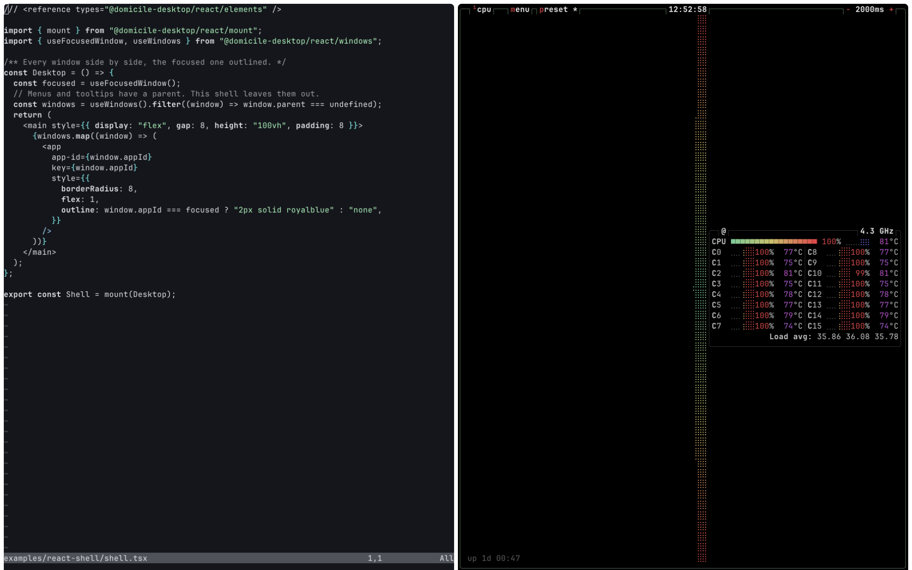

# Shell quickstart

A shell is a web page that draws the desktop. Each window is an `<app>`
element: put it where the window goes and style it with CSS. Write it in React
or in plain JavaScript.

## 1. Install Domicile

Install it from your distribution's packages or Nix:
[Install](use/INSTALL.md).

## 2. Write a shell

<!-- tab: React -->

`shell.tsx`, anywhere:

```tsx
/// <reference types="@domicile-desktop/react/elements" />

import { mount } from "@domicile-desktop/react/mount";
import { useFocusedWindow, useWindows } from "@domicile-desktop/react/windows";

/** Every window side by side, the focused one outlined. */
const Desktop = () => {
  const focused = useFocusedWindow();
  // Menus and tooltips have a parent. This shell leaves them out.
  const windows = useWindows().filter((window) => window.parent === undefined);
  return (
    <main style={{ display: "flex", gap: 8, height: "100vh", padding: 8 }}>
      {windows.map((window) => (
        <app
          app-id={window.appId}
          key={window.appId}
          style={{
            borderRadius: 8,
            flex: 1,
            outline: window.appId === focused ? "2px solid royalblue" : "none",
          }}
        />
      ))}
    </main>
  );
};

export const Shell = mount(Desktop);
```

- `mount(Desktop)` is the shell: Domicile calls it with the desktop.
- `useWindows()` is every window, and rerenders when one opens or closes.
- `<app app-id>` shows that window. A click on it gives it the keyboard.

<!-- tab: JavaScript -->

`shell.js`, anywhere:

```js
/** Every window side by side, the focused one outlined. */
export const Shell = (root, domicile) => {
  const main = document.createElement("main");
  main.style.cssText = "display: flex; gap: 8px; height: 100vh; padding: 8px";
  root.append(main);
  const shown = new Map();

  const draw = () => {
    // Menus and tooltips have a parent. This shell leaves them out.
    const windows = (domicile.windows.list ?? []).filter(
      (window) => window.parent === undefined,
    );
    for (const [appId, app] of shown) {
      if (!windows.some((window) => window.appId === appId)) {
        app.remove();
        shown.delete(appId);
      }
    }
    for (const { appId } of windows) {
      let app = shown.get(appId);
      if (app === undefined) {
        app = document.createElement("app");
        app.setAttribute("app-id", appId);
        app.style.cssText = "border-radius: 8px; flex: 1";
        main.append(app);
        shown.set(appId, app);
      }
      app.style.outline =
        appId === domicile.windows.focused ? "2px solid royalblue" : "none";
    }
  };

  draw();
  domicile.windows.on("change", draw);
  domicile.windows.on("focuschange", draw);
};
```

- `Shell` is the shell: Domicile calls it with the page's `<body>` and the
  desktop.
- `domicile.windows.list` is every window. `change` says one opened, closed or
  changed, and `focuschange` that another has the keyboard.
- `<app app-id>` shows that window. A click on it gives it the keyboard.

<!-- /tabs -->

## 3. Run it

<!-- tab: React -->

```sh
domicile ./shell.tsx
```

Domicile builds it, with React and `@domicile-desktop/*` from its own
install. There is no project to set up.

<!-- tab: JavaScript -->

```sh
domicile ./shell.js
```

It imports nothing, so Domicile runs it as it is. There is no project to set
up.

<!-- /tabs -->

- In a desktop session it opens in a window; from a console login it takes
  the screen.
- It prints `XDG_RUNTIME_DIR` and `WAYLAND_DISPLAY`. Start an app with both
  set and it opens on your shell.



## 4. Change it

Edit the shell, then, in a terminal on the desktop:

<!-- tab: React -->

```sh
domicile load-shell ./shell.tsx
```

<!-- tab: JavaScript -->

```sh
domicile load-shell ./shell.js
```

<!-- /tabs -->

Windows stay open across the reload.

For your editor's types, install the packages beside it:

<!-- tab: React -->

```sh
bun add -d @domicile-desktop/react@next @domicile-desktop/sdk@next @types/react
```

<!-- tab: JavaScript -->

```sh
bun add -d @domicile-desktop/sdk@next
```

Then put `// @ts-check` at the top of `shell.js` and
`/** @type {import("@domicile-desktop/sdk/shell").Shell} */` above `Shell`.

<!-- /tabs -->

## Next

- **Start from manganese** instead of from nothing:
  [SHELL-FROM-MANGANESE.md](SHELL-FROM-MANGANESE.md).
- **How a shell works**: windows, popups, focus, keys, options:
  [WRITING-A-SHELL.md](WRITING-A-SHELL.md).
- **Hooks**: displays, theme, idle, lock, portals:
  [`@domicile-desktop/react`](/packages/react/README.md).
- **Browser windows** are `<webview>`s:
  [SHELL-BROWSER-WINDOWS.md](SHELL-BROWSER-WINDOWS.md).
- **Dialogs**: until a shell answers an app's portal request (a file picker, a
  screen share), the app waits. Draw them with
  `@domicile-desktop/component-library`'s `PortalDialogs`, or refuse them:
  [PORTALS.md](PORTALS.md).
- **Ship it**: [SHELL-PACKAGING.md](SHELL-PACKAGING.md).
- This shell is [`examples/react-shell`](/examples/react-shell) in React and
  [`examples/vanilla-shell`](/examples/vanilla-shell) in JavaScript.
