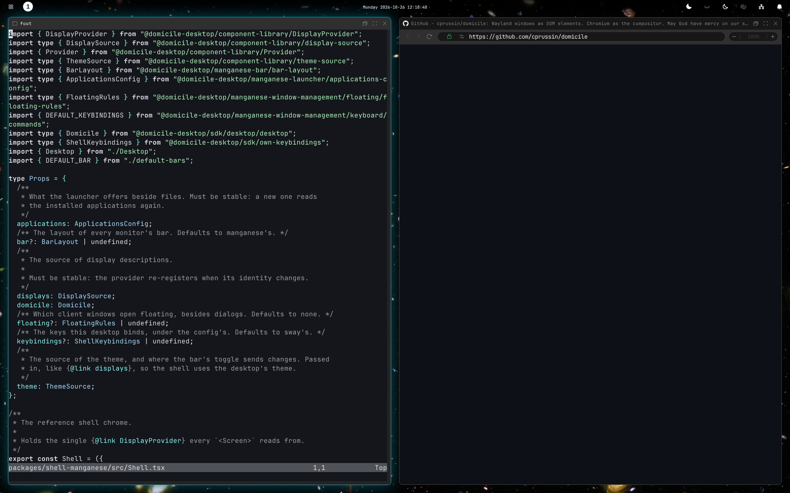
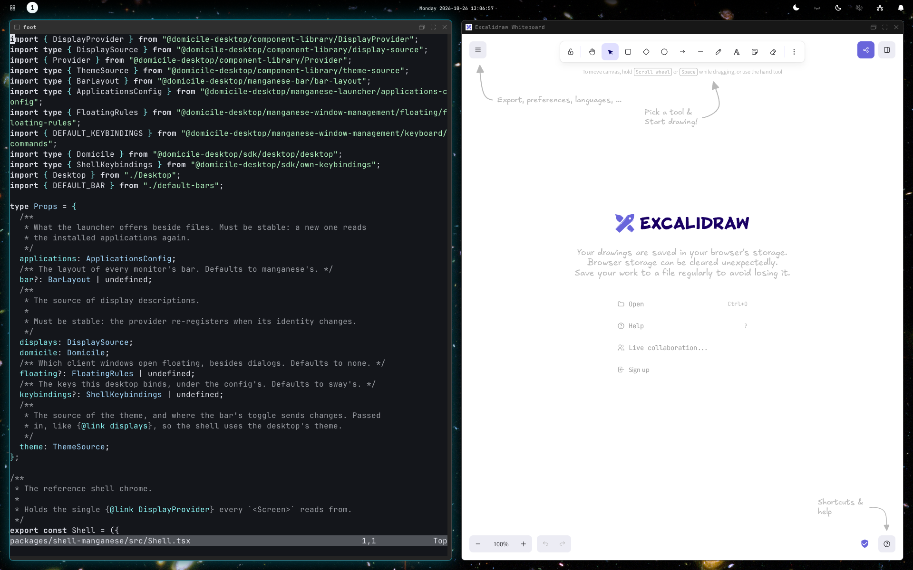

# Browsing

The browser is part of the desktop. Each site opens in its own window, which
tiles beside your apps like any other.



## Open a site

- Press Meta+Space, type an address or a search, and press Enter.
- Meta+Shift+Space opens the address you copied, or searches for the text.
- Links clicked in your apps open here too, and so do PDFs, images and videos
  you open from the launcher.
- `domicile open <address>` opens one from a terminal.

A new tab is a new window: it opens beside the one you were in, in the same
group. Meta+W puts a group in tabs.

## The address bar

Each browser window has one, with:

- Back, forward and reload.
- **The connection**: a lock on a secure site, a warning on one that is not.
  Click it for why.
- **Site permissions**: what this site may use, such as camera, microphone,
  notifications and location. Change them there.
- **Zoom**: out, in, and the level, which resets to 100% when clicked.
- **Downloads**, while there are any: how far each has come.

Right-click a page for its menu: open a link in a new window, copy or save an
image, search for the selection.

## Private windows

The launcher offers each site and search a second time, private. A private
window's address bar is tinted and says "Private", and its cookies and history
are forgotten when the last private window closes. Windows a private window
opens are private too.

Type `!p` anywhere in the launcher to see only private choices.

## Web apps

A site can be an app: it opens in its own window with no address bar, and is
listed in the launcher by name.



- **Add one** from a terminal: `domicile install-app <address>`. It reads the
  site's name and icon from the site.
- **Remove it** with `domicile uninstall-app <address>`.
- **Open a site as an app once**, without adding it:
  `domicile open --app <address>`.
- Links that leave the app's site open in a browser window.

On NixOS, list them in your home configuration:

```nix
programs.domicile.webApps.Music = {
  url = "https://music.example/";
  icon = "multimedia-audio-player";
};
```

## Extensions

Chrome extensions work in every browser window. Their buttons sit in the top
bar's tray; a click opens the extension's popup under it.

<!-- tab: Settings app -->

Open **Settings**, then **Extensions**. Switch each one on or off, open its
options, or **Load unpacked folder** to add one from a folder.

<!-- tab: Config file -->

List Chrome Web Store ids, or folders of unpacked extensions:

```json
{
  "extensions": {
    "web_store": ["ddkjiahejlhfcafbddmgiahcphecmpfh"],
    "unpacked": ["~/src/my-extension"]
  }
}
```

Listed extensions install without asking. Taking one off the list uninstalls
it.

<!-- /tabs -->

## Differences from Chrome

The browser is Chromium, with the desktop in place of Chrome's own window and
menus. So:

- **No saved passwords, autofill or translation.** Use a password manager
  extension. Bitwarden is the one checked here: its popup, sign-in window and
  passkeys. Others are untested.
- **Passkeys come from your password manager extension.** The browser has no
  passkey prompt of its own.
- **No Chrome sign-in or sync.** Chrome's settings and profile menu aren't
  here.
- **No `chrome://` pages and no Print Preview.** Ctrl+Shift+P prints through
  the desktop's print dialog.
- **Manifest V3 extensions only.** uBlock Origin Lite works; uBlock Origin
  does not.
- **Some extension features are missing,** such as items in the right-click
  menu, extension shortcuts and moving tabs.

Sites are told the browser is Google Chrome, as some sign-ins require.

## History and site data

- **History**, in the launcher, lists the pages you visited by day, with
  search and **Clear browsing data**.
- Settings' **Site permissions** lists every site's permissions, and
  **Site data** what each site stores, largest first, with **Remove**.
