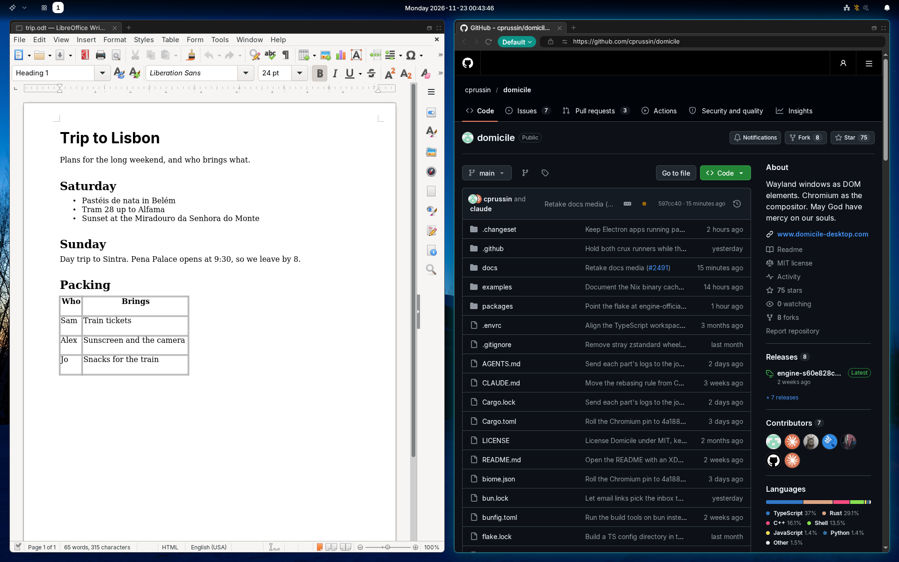
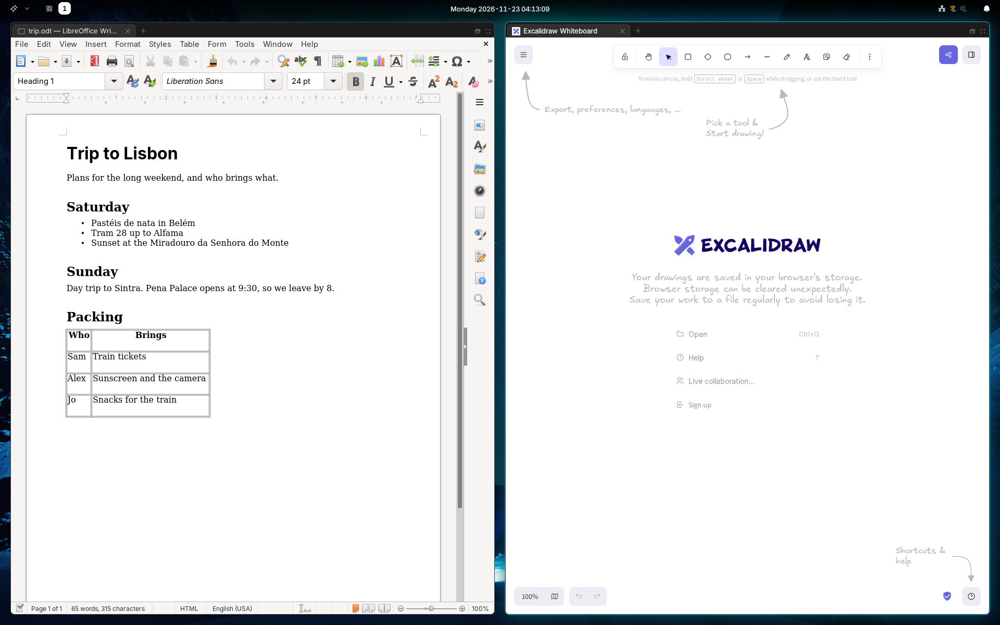

# Browsing

The browser is part of the desktop. Each site opens in its own window, which
tiles beside your apps like any other.



## Open a site

- Press Meta+Space, type an address or a search, and press Enter.
- Meta+Shift+Space opens the address you copied, or searches for the text.
- Links clicked in your apps open here too, and so do PDFs, images and videos
  you open from the launcher.
- `domicile open <address>` opens one from a terminal.
- Drag text, a link or an image onto a group's tabs: a blue bar shows where
  the new tab goes. Text is searched, or opened if it is an address.

A new tab is a new window: it opens beside the one you were in, in the same
group. Meta+W merges groups side by side into one group of tabs.

## The address bar

Each browser window has one, with:

- Back, forward and reload.
- **The connection**: a lock on a secure site, a warning on one that is not.
  Click it for why.
- **Site permissions**: what this site may use, such as camera, microphone,
  notifications and location. Change them there.
- **Zoom**: out, in, and the level, which resets to 100% when clicked.
- **Downloads**, while there are any: how far each has come.

Right-click a page for its menu: open a link in a new window, copy or save an
image, search for the selection.

## Profiles

A profile keeps a part of your life apart, such as work and personal. Each has
its own sign-ins, site data and extensions, and opens the sites you give it.
Sites you haven't given a profile open in your default one.

The button at the start of the address bar shows the page's profile. Click it
to:

- Move the page to another profile, or open it in a new window of one.
  Middle-click or Ctrl+click a profile to open the page in a new window of it.
- Open this site in a profile from now on.
- Switch the profile's extensions on and off.

Tabs outside your default profile carry a dot of their profile's color.
Following a link to another profile's site moves the page there.

<!-- tab: Settings app -->

Open **Settings**, then **Profiles**: a card for each profile with its color
and extension switches, and the sites that open outside your default profile.
The arrows on a card move the profile up or down, in Settings and in the
profile menu. The rainbow circle after the colors picks any color.

<!-- tab: Config file -->

```json
{
  "browser": {
    "profiles": {
      "personal": { "name": "Personal", "color": "#0d9488" },
      "work": { "name": "Work", "color": "#d97706" },
      "private": { "name": "Private", "color": "#a78bfa", "private": true }
    },
    "order": ["personal", "work", "private"],
    "default_profile": "personal",
    "default_private_profile": "private",
    "sites": { "*.acme.com": "work" }
  }
}
```

`order` is the order the profile menu and Settings list the profiles in.
Profiles it leaves out follow, by id.

<!-- /tabs -->

## Private windows

The launcher offers each site and search a second time, private. A private
window's address bar is tinted and says "Private", and its cookies and history
are forgotten when the last private window closes. Windows a private window
opens are private too.

Type `!p` anywhere in the launcher to see only private choices.

## Web apps

A site can be an app: it opens in its own window with no address bar, and is
listed in the launcher by name.



- **Add one** from a terminal: `domicile install-app <address>`. It reads the
  site's name and icon from the site.
- **Remove it** with `domicile uninstall-app <address>`.
- **Open a site as an app once**, without adding it:
  `domicile open --app <address>`.
- Links that leave the app's site open in a browser window.

On NixOS, list them in your home configuration:

```nix
programs.domicile.webApps.Music = {
  url = "https://music.example/";
  icon = "multimedia-audio-player";
};
```

## Extensions

Chrome extensions work in every browser window. Their buttons sit in the top
bar's tray; a click opens the extension's popup under it.

An extension is installed in every profile, with its own data in each, and is
on only in the profiles you choose. The tray's menu switches it on or off in
the profile of the page you're on.

<!-- tab: Settings app -->

Open **Settings**, then **Extensions** to see which profiles each one is on
in, change what it can reach, open its options, or **Load unpacked folder** to
add one from a folder; it asks which profiles to turn it on in. **Choose
profiles** opens **Profiles**, where each profile has a switch for each
extension.

<!-- tab: Config file -->

List Chrome Web Store ids, or folders of unpacked extensions:

```json
{
  "extensions": {
    "web_store": ["ddkjiahejlhfcafbddmgiahcphecmpfh"],
    "unpacked": ["~/src/my-extension"]
  }
}
```

Listed extensions install without asking. Taking one off the list uninstalls
it.

<!-- /tabs -->

## Spelling

Text fields in pages, web apps and Electron apps underline misspelled words.
Right-click one for suggestions, or **Add to dictionary** to stop it being
marked.

Spelling is checked in American English unless you choose other languages in
your config file:

```json
{ "spellcheck": { "languages": ["en-US", "de-DE"] } }
```

On NixOS:

```nix
programs.domicile.settings.spellcheck.languages = ["en-US" "de-DE"];
```

Set `enabled` to `false` to turn it off. Dictionaries come with the desktop,
and your words are never sent anywhere to be checked.

## Privacy

Every profile keeps these from the sites you visit, unless you turn one off:

- **Block ads and trackers.** Ads, and the trackers that follow you from site
  to site, never load, and the boxes they would have filled are hidden.
  Standard blocks what other sites put on a page; Strict also blocks a site's
  own, which can break some sites. Private windows use Strict.
- **Hide your device's details.** Sites see slightly different graphics,
  audio and processor details on each start, and each site different ones, so
  they can't recognize you by them.
- **Remove tracking from links.** A link from one site to another loses what
  tells the next site where you clicked it (`fbclid`, `gclid` and the like),
  and with Strict ad blocking its campaign tags (`utm_`) too.
- **Hide cookie banners.** The pop-ups that ask you to accept cookies are
  hidden, without accepting anything.
- **Block cookies from other sites.** A page's ads, buttons and embeds from
  other sites can't keep cookies that follow you from site to site. Sign-ins
  that open in their own window still work.
- **Ask sites not to sell or share your data.** Pages are sent Global Privacy
  Control, which some places' laws make sites honor.
- **Hide your local network address.** Video calls and other sites see the
  address your network shows the internet, not the one on your home or office
  network.

Ads are blocked with the lists uBlock Origin uses by default: EasyList,
EasyPrivacy and uBlock Origin's own. They're kept up to date by themselves,
and kept on your computer, so blocking works before you're online.

### When a site doesn't work

The shield at the end of the address field shows how many ads and trackers
were blocked on the page. If a site breaks, open it and turn **Protections**
off. It asks how long:

- **This window only** turns them off until you close the window.
- **Always on this site** keeps them off for that site in this profile.

Either way the page reloads. Turn the switch back on to block again. The shield
is outlined while protections are off. You can also pick Strict for one site
there.

<!-- tab: Settings app -->

Open **Settings**, then **Privacy**. **Website protections** has a choice of
Standard, Strict or Off for ads and trackers, and a switch for each of the
rest, for the profile you choose.
**Sites you changed** lists the sites you turned protections off for, set
to Strict, or turned one protection off for, from the shield. **Turn back on**
or **Remove** undoes one.

<!-- tab: Config file -->

```json
{
  "browser": {
    "profiles": {
      "default": { "name": "Default", "color": "#0d9488" },
      "work": {
        "name": "Work",
        "color": "#d97706",
        "protections": {
          "block_ads_and_trackers": "off",
          "block_third_party_cookies": false
        }
      },
      "private": { "name": "Private", "color": "#a78bfa", "private": true }
    },
    "block_rules": ["||ads.example.com^", "@@||example.org/ads.js"]
  }
}
```

`protections` takes `block_ads_and_trackers`, which is `"standard"`,
`"strict"` or `"off"`, and `block_third_party_cookies`,
`global_privacy_control`, `hide_local_ip_address`,
`remove_tracking_from_links`, `hide_device_details` and
`hide_cookie_banners`, each `true` unless set.

`browser.block_lists` replaces the lists: each is an `https:` address or a
file's absolute path, in the syntax uBlock Origin and Adblock Plus read.
`browser.block_rules` adds rules of your own in the same syntax, in every
profile that blocks ads: a rule that starts with `@@` lets something load that
a list blocks. `browser.cookie_banner_lists` replaces the lists cookie banners
are hidden with, the EasyList Cookie List and uBlock Origin's cookie notices
unless set.

<!-- /tabs -->

## Differences from Chrome

The browser is Chromium, with the desktop in place of Chrome's own window and
menus. So:

- **No saved passwords, autofill or translation.** Use a password manager
  extension. Bitwarden is the one checked here: its popup, sign-in window and
  passkeys. Others are untested.
- **Passkeys come from your password manager extension.** The browser has no
  passkey prompt of its own.
- **No Chrome sign-in or sync.** Chrome's settings and profile menu aren't
  here.
- **No `chrome://` pages and no Print Preview.** Ctrl+Shift+P prints through
  the desktop's print dialog.
- **Manifest V3 extensions only.** uBlock Origin Lite works; uBlock Origin
  does not.
- **Some extension features are missing,** such as moving tabs.

Sites are told the browser is Google Chrome, as some sign-ins require.

## History and site data

- **History**, in the launcher, lists the pages you visited by day, with
  search and **Clear browsing data**.
- Settings' **Site permissions** lists every site's permissions, and
  **Site data** what each site stores, largest first, with **Remove**.
