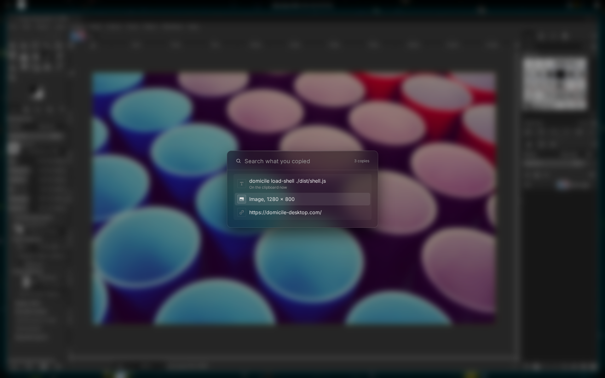

# Clipboard

Meta+Shift+V shows what you copied, newest first. Pick one to paste it next.

- It keeps the last 32 copies, text and images.
- A copy stays after the app you copied from closes.
- It is kept in memory only, and forgotten when you log out.
- Highlighted text that you did not copy stays out of it.
- Meta+Shift+Space opens what you copied: the address, or a search for the
  text.

Clipboard tools such as `wl-copy` and `wl-paste` work too.
