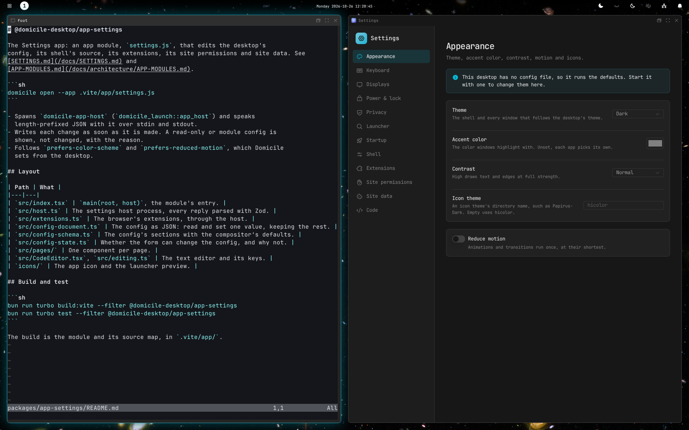

# Settings and the config file

Everything you can set is in two places: the **Settings** app, and a config
file. They are the same settings, so use whichever you like. Each guide page
shows both.



## The Settings app

Open **Settings** from the launcher. A change applies at once and is saved to
your config file.

| Page | What's there |
|---|---|
| Appearance | [Theme, accent color, contrast, motion, icons](APPEARANCE.md) |
| Keyboard | [Layouts](#keyboard-layout) |
| Displays | [Monitor profiles](MONITORS.md) |
| Power & lock | [Blank and lock when away](LOCK-AND-IDLE.md) |
| Privacy | [What apps are asked not to do](#privacy) |
| Launcher | [Files left out of the search](LAUNCHER.md#leave-files-out) |
| Startup | [Apps to start when you log in](#start-apps-when-you-log-in) |
| Shell | Manganese's own options: the [clock](TOP-BAR.md#the-clock), [night light and brightness](MONITORS.md#night-light) |
| Extensions | [Browser extensions](BROWSER.md#extensions) |
| Site permissions, Site data | [What sites may do and store](BROWSER.md#history-and-site-data) |
| Code | The config file, in a text editor |

## The config file

`~/.config/domicile/domicile.json`. The desktop reloads it when you save;
windows stay open.

```json
{
  "$schema": "https://domicile-desktop.com/config.schema.json",
  "shell": "@domicile-desktop/manganese",
  "theme": { "mode": "dark" },
  "idle": { "blank_after_seconds": 600, "lock_after_seconds": 900 }
}
```

- `$schema` lets your editor complete and check it.
- A mistake is logged, and the last good settings stay.
- `domicile check-config ~/.config/domicile/domicile.json` checks it.
- If the file is read-only, as with home-manager, Settings shows it but
  can't change it.

### A config module

Keys, the top bar and floating rules are set in code. Rename the file to
`domicile.tsx` and export the settings and the shell:

```tsx
import { runManganese } from "@domicile-desktop/manganese";

export const theme = { mode: "dark" };
export const Shell = runManganese({
  // keybindings, bar, floating, applications
});
```

- Each export other than `Shell` is a section of the JSON.
- Settings shows what it evaluates to, and its **Code** page edits it.

### Home-manager

On NixOS, `programs.domicile.settings` writes the file:

```nix
programs.domicile.settings.theme.mode = "dark";
```

`programs.domicile.configDirectory = ./domicile;` builds a config module
instead. See [SHELL-CONFIG.md](../SHELL-CONFIG.md#home-manager).

## Keyboard layout

<!-- tab: Settings app -->

Open **Settings**, then **Keyboard**. Set the **Layout**, such as `us` or
`de`, and the **Variant**, such as `dvp` or `colemak`. **Options** takes xkb
options such as `caps:escape`.

To switch between layouts, add a keymap for each under **New keymap**. The
desktop starts on the first.

<!-- tab: Config file -->

```json
{ "input": { "keyboard": { "xkb_layout": "us", "xkb_variant": "dvp", "xkb_options": ["caps:escape"] } } }
```

To switch between layouts, list them as keymaps. The desktop starts on the
first:

```json
{
  "input": {
    "keyboard": {
      "keymaps": [
        { "name": "dvp", "xkb_variant": "dvp" },
        { "name": "us" }
      ]
    }
  }
}
```

<!-- /tabs -->

With more than one keymap, the [top bar](TOP-BAR.md) shows which you are on.
Click it to switch.

## Start apps when you log in

<!-- tab: Settings app -->

Open **Settings**, then **Startup**, and **Add a command**.

<!-- tab: Config file -->

Each command is a list: the program, then its arguments.

```json
{ "startup": { "commands": [["nm-applet"], ["sh", "-c", "mako > /dev/null"]] } }
```

<!-- /tabs -->

These run once when you log in, not when you save. Apps in
`~/.config/autostart` start too.

## Privacy

<!-- tab: Settings app -->

Open **Settings**, then **Privacy**. Each switch asks apps not to use the
camera, the microphone, your location, sound, printing, saving files or
opening other apps.

<!-- tab: Config file -->

```json
{ "lockdown": { "disable_camera": true, "disable_microphone": true } }
```

The others are `disable_location`, `disable_sound_output`,
`disable_printing`, `disable_save_to_disk` and
`disable_application_handlers`.

<!-- /tabs -->

Apps that support this follow it. It doesn't stop an app that ignores it.

Every setting, in full: [SHELL-CONFIG.md](../SHELL-CONFIG.md).
