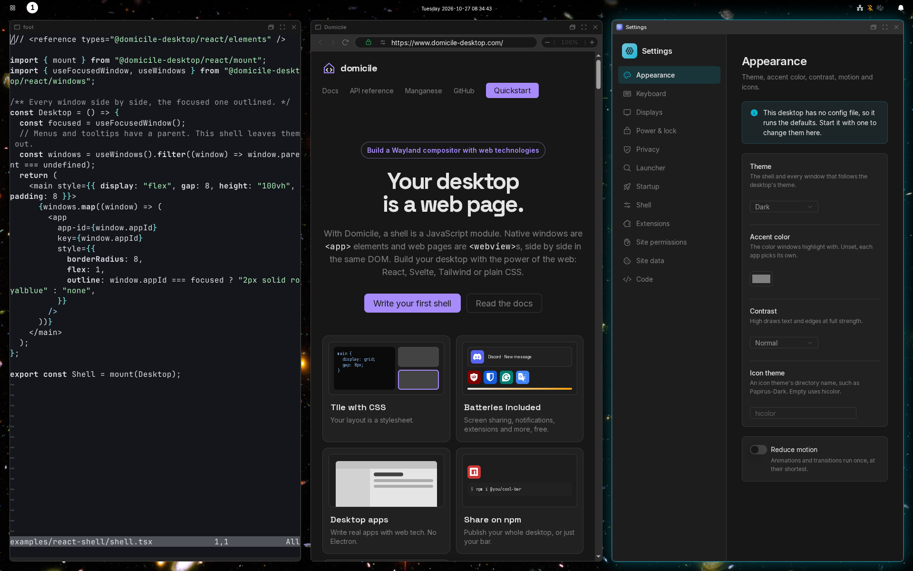

# First steps

You logged in to Domicile with manganese. Here is how to get around.

- **The Meta key** (the Windows or Super key) drives the desktop. Every
  shortcut is listed in [Keys](KEYS.md).
- **Open anything** with Meta+Space: apps, files, websites and searches. See
  [The launcher](LAUNCHER.md).
- **Windows tile.** Each new window takes a share of the screen. See
  [Windows and workspaces](WINDOWS.md).
- **The browser is built in.** Type a web address or a search into the
  launcher and it opens as a window, tiled beside your apps. See
  [Browsing](BROWSER.md).
- **The top bar** shows your workspaces, the clock, sound, network, battery
  and notifications. See [The top bar](TOP-BAR.md).
- **Lock** with Meta+Shift+Return. Your password unlocks it.

## Open a terminal

Manganese has no terminal key at first. Open one from the launcher: press
Meta+Space, type its name, press Enter. To give it a key, see
[Keys](KEYS.md#add-your-own).

## Set it up

Open **Settings** from the launcher to pick your keyboard layout, theme,
monitors and more. Every setting is also a line in a
[config file](CONFIGURE.md), if you prefer a file.

## Your apps

Linux apps that speak Wayland run here: GTK, Qt, SDL and Electron apps are
started in Wayland mode. There is no Xwayland, so apps that only speak X11
don't run ([Known gaps](/KNOWN-GAPS.md)).

Websites can be apps too: they open in their own window without an address
bar, and show in the launcher. See [Web apps](BROWSER.md#web-apps).

### Apps we check

The website's screenshots and videos are taken on a real desktop, so each
capture checks that these apps open and draw: SuperTuxKart, mpv, Blender,
GIMP 3, LibreOffice and foot. They run on an NVIDIA card. Other Wayland apps
are expected to work, but nothing checks them.
