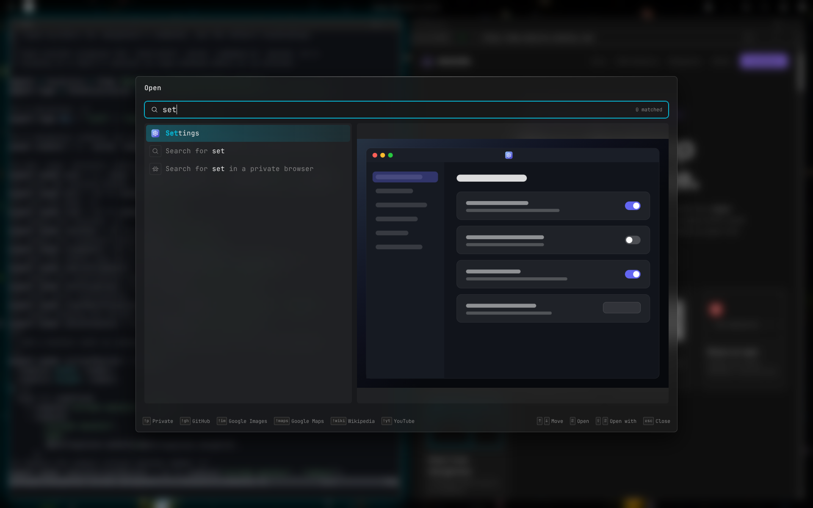

# The launcher

Press Meta+Space (or Meta+D, or the button at the left of the bar) and type.
The launcher finds apps, files, websites and searches. Enter opens the
highlighted row; a preview of it shows beside the list.



## What it finds

In this order:

1. **Site shortcuts**: `!wiki`, `!yt` and the other tags listed at the
   bottom search that site. `!gh cprussin/domicile` goes to that GitHub page.
   Type `!` to see every tag and what it does; Enter or Tab fills one in.
2. **A web address**, if you typed one.
3. **Apps and bookmarks**, by name.
4. **A path**, if you typed one.
5. **Files** in your home folder.
6. **A web search** for what you typed. Always there.

Sites and searches each have a private row beside them. `!p` shows only
private rows. See [Private windows](BROWSER.md#private-windows).

## Files

- Enter opens a file in its usual app. Shift+Enter asks which app to use.
- Folders, images, PDFs, music, videos and text files show a preview.
- Hidden files (names starting with `.`) are left out.

Set a file type's app in `~/.config/mimeapps.list`, or in
`~/.config/domicile-mimeapps.list` for Domicile alone:

```ini
[Default Applications]
text/plain=org.gnome.TextEditor.desktop
```

## Leave files out

<!-- tab: Settings app -->

Open **Settings**, then **Launcher**. Add patterns under **Left out of the
file search**.

<!-- tab: Config file -->

```json
{ "files": { "omit": ["**/.*", "node_modules", "Scratch/**"] } }
```

<!-- /tabs -->

- Patterns are relative to your home folder, as in a `.gitignore`: `*` stays
  within a folder, `**` crosses folders, and `!` puts something back.
- Setting the list replaces the default, `**/.*`, which hides hidden files.
  Keep it in your list to keep them hidden.

## Hide apps, add bookmarks

In a [config module](CONFIGURE.md#a-config-module):

```tsx
export const Shell = runManganese({
  applications: {
    omit: ["htop.desktop"],
    bookmarks: [
      { name: "Calendar", url: "https://calendar.google.com" },
    ],
  },
});
```

- `omit` hides apps by their desktop file's name, with the same patterns as
  files.
- A bookmark opens its page in a browser window. Its icon is the site's.

## Built-in entries

The launcher also lists Settings, History, Screenshot, Screen Record,
Shutdown, Reboot and Logout. The last three ask first.

More: [the launcher's design](../../packages/manganese-launcher/docs/LAUNCHER.md),
[its sources](../LAUNCHER.md).
