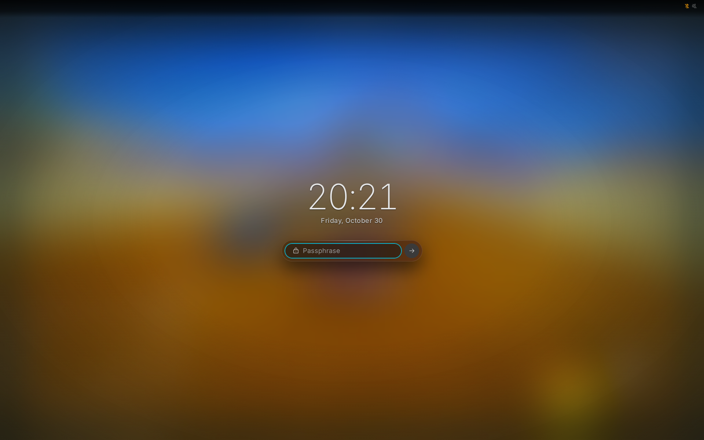

# Locking and sleep

Meta+Shift+Return locks the screen. Your password unlocks it.



- The desktop also locks before the machine sleeps, and when you have been
  away for the time you set below.
- The lock screen's bar shows the battery, Bluetooth, and the brightness,
  volume and keyboard layout, which you can change.
- Notifications wait until you unlock.

## Blank and lock when away

<!-- tab: Settings app -->

Open **Settings**, then **Power & lock**. Set **Blank the screens after** and
**Lock after**, in seconds. Leave either empty to never do it.

<!-- tab: Config file -->

```json
{ "idle": { "blank_after_seconds": 600, "lock_after_seconds": 900 } }
```

Leave a key out to never do it.

<!-- /tabs -->

- Any key or pointer motion lights the screens again.
- The two run on their own clocks, so the screen can lock before it blanks.
- Videos that are playing keep the screens on. So does the eye in the
  [top bar](TOP-BAR.md), until you click it again.

## If it won't unlock

The password is checked by the system's `domicile` login service. The
packages and the NixOS module add it. Without it the screen locks and nothing
unlocks it; switch to a console (Ctrl+Alt+F2) and add
`/etc/pam.d/domicile`. See [LOCK.md](../LOCK.md#verifiers).

To check passwords with another service, set it in Settings' **Power &
lock** (**PAM service**) or in the config as `lock.pam_service`.
