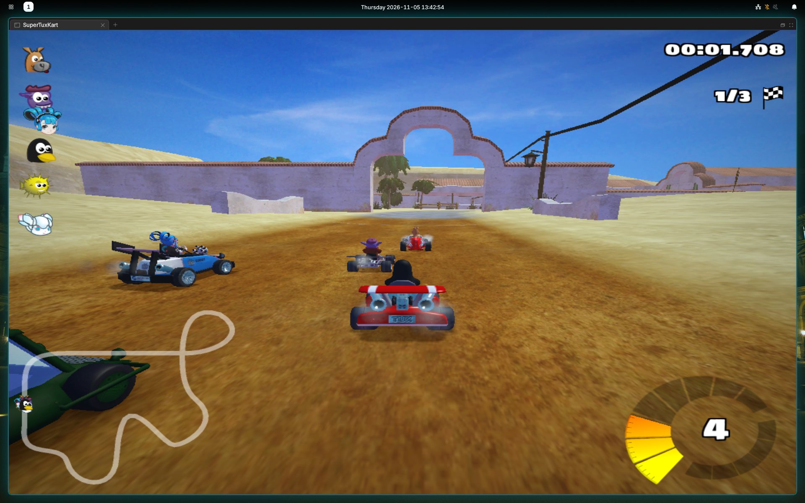

# Locking and sleep

Meta+Shift+Return locks the screen. Your password unlocks it.



- The desktop also locks before the machine sleeps, and when you have been
  away for the time you set below.
- The lock screen's bar shows the battery, Bluetooth, and the brightness,
  volume and keyboard layout, which you can change.
- Notifications wait until you unlock.

## Blank and lock when away

<!-- tab: Settings app -->

Open **Settings**, then **Power & lock**. Set **Blank the screens after** and
**Lock after**, in seconds. Leave either empty to never do it.

<!-- tab: Config file -->

```json
{ "idle": { "blank_after_seconds": 600, "lock_after_seconds": 900 } }
```

Leave a key out to never do it.

<!-- /tabs -->

- Any key or pointer motion lights the screens again.
- The two run on their own clocks, so the screen can lock before it blanks.
- Videos that are playing keep the screens on. So does the eye in the
  [top bar](TOP-BAR.md), until you click it again.

## If it won't unlock

The password is checked by the system's `domicile` login service. The
packages and the NixOS module add it; `nix run` doesn't. Without it the screen
doesn't lock at all, not even when the computer sleeps, and a notification
from Domicile says so when it starts.

If the screen is locked and your password is refused, the check broke after
it locked:

- **In a window on another desktop:** close the window, or press Ctrl+C in
  the terminal you started it from.
- **On the whole screen:** press Ctrl+Alt+F3, sign in and fix the check
  ([LOCK.md](../LOCK.md#verifiers)). Switch back and unlock with your
  password. Nothing is lost.
- **Or end that sign-in** from the other console. `loginctl list-sessions`
  shows its session id by its `TTY`; run `loginctl terminate-session <id>`.
  Anything unsaved in its windows is lost. Other Domicile desktops keep
  running.

To check passwords with another service, set it in Settings' **Power &
lock** (**PAM service**) or in the config as `lock.pam_service`.
