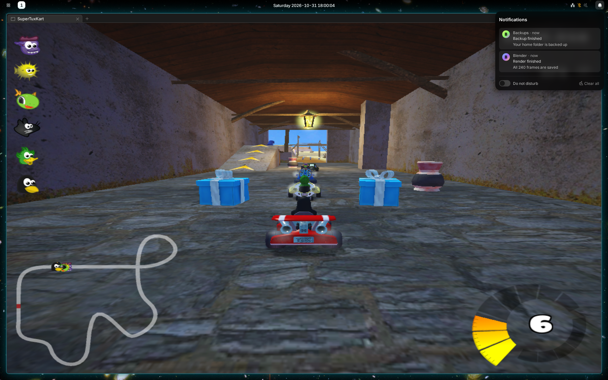

# Notifications

Notifications from apps and websites pop up at the top right of the monitor
you are using.

- Hover to spread them out. Click one to act on it; swipe right or press its
  close button to dismiss it.
- Some have a reply field, such as a chat message's.
- Urgent ones have a red ring and stay until you dismiss them.
- **The bell** at the right of the bar counts what came in since you last
  looked. Click it for every notification you haven't cleared, and
  **Clear all**.
- Nothing pops up while the screen is locked, or while you
  [cast to a TV](MONITORS.md#cast-to-a-tv). They still wait in the bell.

A site asks before it sends notifications. Change your answer in its
[site permissions](BROWSER.md#the-address-bar).

## Inboxes

Your config can list Gmail accounts and Google Messages at the top of the
bell's panel, under **Inboxes**
([how](../../packages/shell-manganese/docs/TOP-BAR.md#inboxes)).

- Unread conversations are in a badge on each, and add to the bell's number
  until you read them. Gmail also shows how many conversations it has.
- Click a Gmail inbox to open it in a browser window.
- Click Messages to open it right in the panel. The back arrow returns to
  your notifications.
