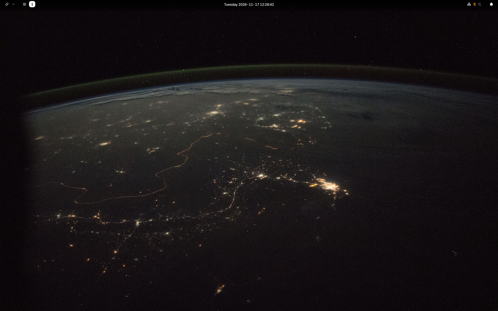
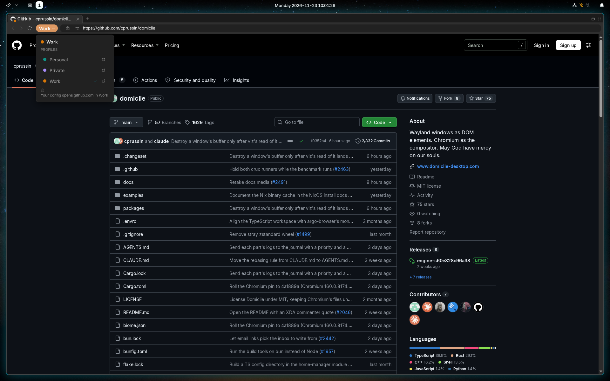
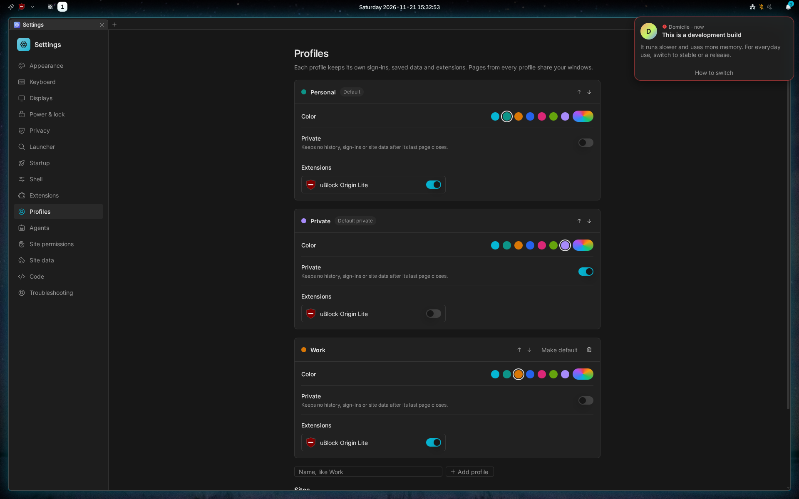
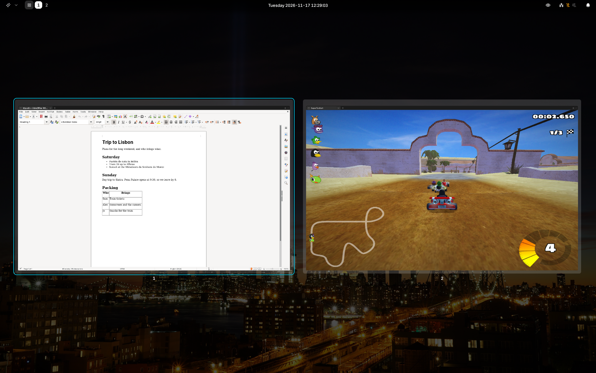
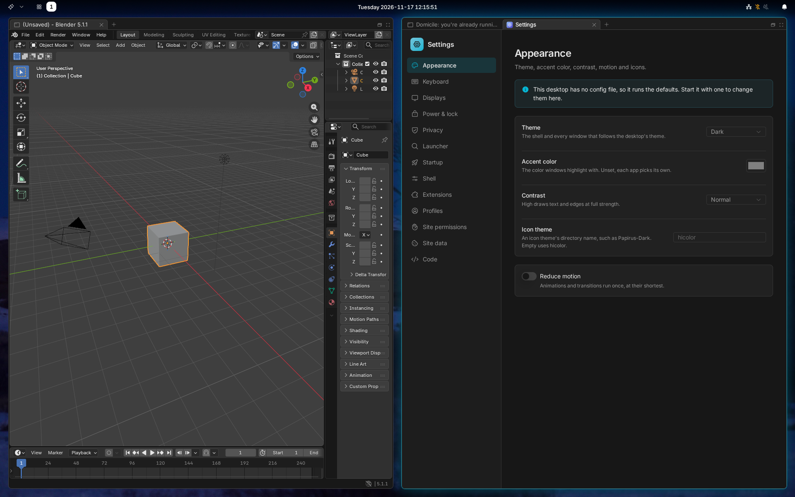

# Release notes

What's new in manganese, the desktop, in each release. What's new for people
building shells is in [Domicile's release notes](../RELEASE-NOTES.md).

## 1.3.0

_Unreleased_

### Electron apps on the desktop's browser

Slack, Element, Claude and other Electron apps run on the desktop's browser, with menus and dialogs in the desktop's style.

[How to turn it on](ELECTRON-APPS.md) · [#2091](https://github.com/cprussin/domicile/pull/2091) · [#2162](https://github.com/cprussin/domicile/pull/2162) · [#2173](https://github.com/cprussin/domicile/pull/2173) · [#2243](https://github.com/cprussin/domicile/pull/2243) · [#2256](https://github.com/cprussin/domicile/pull/2256) · [#2283](https://github.com/cprussin/domicile/pull/2283) · [#2302](https://github.com/cprussin/domicile/pull/2302) · [#2316](https://github.com/cprussin/domicile/pull/2316)

### Let agents use your desktop

Claude Code, claude.ai and other agents can use your desktop, all of it or only the windows you pick. You see each one in the bar while it works, and can stop it at any time.

[How to set it up](AGENTS.md)

### Browser profiles

Keep work and personal apart: each profile has its own sign-ins and extensions, and opens the sites you give it.

[Profiles](BROWSER.md#profiles) · [#2212](https://github.com/cprussin/domicile/pull/2212) · [#2231](https://github.com/cprussin/domicile/pull/2231) · [#2234](https://github.com/cprussin/domicile/pull/2234) · [#2236](https://github.com/cprussin/domicile/pull/2236) · [#2259](https://github.com/cprussin/domicile/pull/2259)

### Also new

- Pop a video out of its page to float it over everything. [#2077](https://github.com/cprussin/domicile/pull/2077) · [#2116](https://github.com/cprussin/domicile/pull/2116) · [#2177](https://github.com/cprussin/domicile/pull/2177)
- HDR per monitor in Settings, and 10-bit color without banding. [Monitors](MONITORS.md) · [#1974](https://github.com/cprussin/domicile/issues/1974)
- Press and hold Back or Forward to jump to any page before or after. [The address bar](BROWSER.md#the-address-bar) · [#2251](https://github.com/cprussin/domicile/pull/2251)
- Ctrl+click Back, Forward, a page in their menus or a profile to open it in a new window, as a middle click does. [The address bar](BROWSER.md#the-address-bar)
- Put your browser profiles in any order and give them any color, in Settings. [Profiles](BROWSER.md#profiles) · [#2263](https://github.com/cprussin/domicile/pull/2263)
- See your saved Wi-Fi networks in quick settings, in range or not: turn joining automatically on or off, or forget one. [The top bar](TOP-BAR.md) · [#2334](https://github.com/cprussin/domicile/pull/2334)
- Quick settings lights Wi-Fi, Wired and Bluetooth while connected. [The top bar](TOP-BAR.md) · [#2266](https://github.com/cprussin/domicile/pull/2266)
- The tray's menu pins icons and switches extensions. [#2137](https://github.com/cprussin/domicile/pull/2137)
- Tap Super, or swipe up with four fingers, for the overview. [Overview](WINDOWS.md#overview) · [#2065](https://github.com/cprussin/domicile/pull/2065) · [#2148](https://github.com/cprussin/domicile/pull/2148)
- Keep one wallpaper instead of a new one every minute: Settings › Shell. [Wallpaper](APPEARANCE.md#wallpaper)
- The night light fades in and out. [Night light](MONITORS.md#night-light) · [#2181](https://github.com/cprussin/domicile/pull/2181)
- Meta+W merges side-by-side windows into tabs. [Layout](KEYS.md#layout) · [#2093](https://github.com/cprussin/domicile/pull/2093)
- Extensions can run in private windows. [Extensions](BROWSER.md#extensions) · [#2060](https://github.com/cprussin/domicile/pull/2060)
- "Sign in with Google" works. [#2086](https://github.com/cprussin/domicile/pull/2086)
- Games can lock the pointer. [#2057](https://github.com/cprussin/domicile/pull/2057) · [#2123](https://github.com/cprussin/domicile/pull/2123)
- Input methods such as fcitx5 and IBus. [#2059](https://github.com/cprussin/domicile/pull/2059) · [#2062](https://github.com/cprussin/domicile/pull/2062)
- Type `!g` in the launcher to search Google straight away, without other matches. [Launcher](LAUNCHER.md)
- Terminal apps in the launcher. [#2069](https://github.com/cprussin/domicile/pull/2069)
- Per-monitor mode, refresh rate and adaptive sync. [Monitors](MONITORS.md) · [#2031](https://github.com/cprussin/domicile/pull/2031) · [#2048](https://github.com/cprussin/domicile/pull/2048)
- Key repeat settings. [#2024](https://github.com/cprussin/domicile/pull/2024)
- Firefox animates with the desktop. [#2087](https://github.com/cprussin/domicile/pull/2087) · [#2089](https://github.com/cprussin/domicile/pull/2089)
- Chromium 160. [#2023](https://github.com/cprussin/domicile/pull/2023)

### Fixes

- A launcher tag typed after the words, as in `kate bush !yt`, searches on Enter instead of filling in the tag again.
- The desktop takes about 35 MB less memory at rest: the browser keeps one process ready for a new page instead of two.
- The desktop takes about 35 MB less memory at rest: the browser starts its audio service only when something plays sound or asks for a microphone or camera.
- Ctrl+C and Escape work when you select an area on screen for a screenshot or a share. [Screenshots](SCREENSHOTS.md)
- The wallpaper takes less memory on screens smaller than 4K: it downloads each photo only as large as your screens show it.
- Screenshot, share and other dialogs fade out when you answer them, instead of vanishing.
- Sharing your screen or a window in Google Meet asks once, not twice.
- A site's notifications show the site's icon instead of the browser's.
- "Open Slack" and other buttons that open an app from a page work again.
- Extensions keep their sign-ins and settings when the desktop restarts, instead of starting over.
- A Gmail notification opens its mail beside your inbox, once Gmail has synced it. [Inboxes](NOTIFICATIONS.md#inboxes) · [#2284](https://github.com/cprussin/domicile/pull/2284)
- PDFs stay sharp and no longer go blank. [#2038](https://github.com/cprussin/domicile/pull/2038) · [#2080](https://github.com/cprussin/domicile/pull/2080) · [#2100](https://github.com/cprussin/domicile/pull/2100)
- Smoother windows on heavy pages, adaptive sync monitors and the overview. [#2227](https://github.com/cprussin/domicile/pull/2227) · [#2094](https://github.com/cprussin/domicile/pull/2094) · [#2041](https://github.com/cprussin/domicile/pull/2041)
- Less battery use while idle. [#2143](https://github.com/cprussin/domicile/pull/2143) · [#2138](https://github.com/cprussin/domicile/pull/2138)
- DisplayLink docks no longer freeze the desktop. [#2043](https://github.com/cprussin/domicile/pull/2043) · [#2045](https://github.com/cprussin/domicile/pull/2045)
- The lock screen always gets your typing. [Locking and sleep](LOCK-AND-IDLE.md) · [#2039](https://github.com/cprussin/domicile/pull/2039) · [#2140](https://github.com/cprussin/domicile/pull/2140)
- A notification says so when the desktop can't use your graphics card. [Graphics problems](TROUBLESHOOTING.md#graphics-problems) · [#2071](https://github.com/cprussin/domicile/pull/2071)

Special thanks to: [ploug](https://github.com/ploug) & [mecattaf](https://github.com/mecattaf)

## 1.2.0

_November 10, 2026_

### The overview

Every workspace on a monitor at once. Meta+O, a four-finger pinch, or the button in the bar.

[#1931](https://github.com/cprussin/domicile/pull/1931) · [#1940](https://github.com/cprussin/domicile/pull/1940) · [#1946](https://github.com/cprussin/domicile/pull/1946)

### Gestures

Four-finger swipes change workspace, swipes in from a touchscreen's edge, and a pinch zooms like on a Mac.

[#1913](https://github.com/cprussin/domicile/pull/1913) · [#1925](https://github.com/cprussin/domicile/pull/1925) · [#1929](https://github.com/cprussin/domicile/pull/1929) · [#1996](https://github.com/cprussin/domicile/pull/1996)

### The desktop's own dialogs

Sign-in, permission and "Open Zoom?" prompts, pickers, tooltips and error pages, in the desktop's style.

[#1893](https://github.com/cprussin/domicile/pull/1893) · [#1895](https://github.com/cprussin/domicile/pull/1895) · [#1898](https://github.com/cprussin/domicile/pull/1898) · [#1901](https://github.com/cprussin/domicile/pull/1901)

### Also new

- Pause notifications for a while. [#2001](https://github.com/cprussin/domicile/pull/2001)
- Night light apps such as gammastep. [#1921](https://github.com/cprussin/domicile/pull/1921)
- Hide the pointer while typing. [#1945](https://github.com/cprussin/domicile/pull/1945)
- Touchpad and mouse settings. [#1884](https://github.com/cprussin/domicile/pull/1884)
- Touchscreens work in apps. [#1924](https://github.com/cprussin/domicile/pull/1924)

## 1.1.1

_November 4, 2026_

- Window and screen shares carry sound. [#1849](https://github.com/cprussin/domicile/pull/1849)
- Middle-click Back or Forward to open it in a new window. [#1848](https://github.com/cprussin/domicile/pull/1848)
- App windows show in VMs without 3D. [#1854](https://github.com/cprussin/domicile/pull/1854) · [#1856](https://github.com/cprussin/domicile/pull/1856)

## 1.0.0

_November 3, 2026_

The first release: a tiling desktop that feels like Sway, where websites tile and tab alongside your apps.

- Sway's layouts and keys, with websites tiling beside your apps.
- Chrome extensions, the launcher, quick settings, notifications and inboxes.
- Clipboard history, screenshots, screen recording and casting to a TV.
- Night light and automatic brightness.
- Settings and History apps.
- Packages for Debian, Ubuntu, Fedora, openSUSE, Arch and NixOS.

[Install](INSTALL.md)
