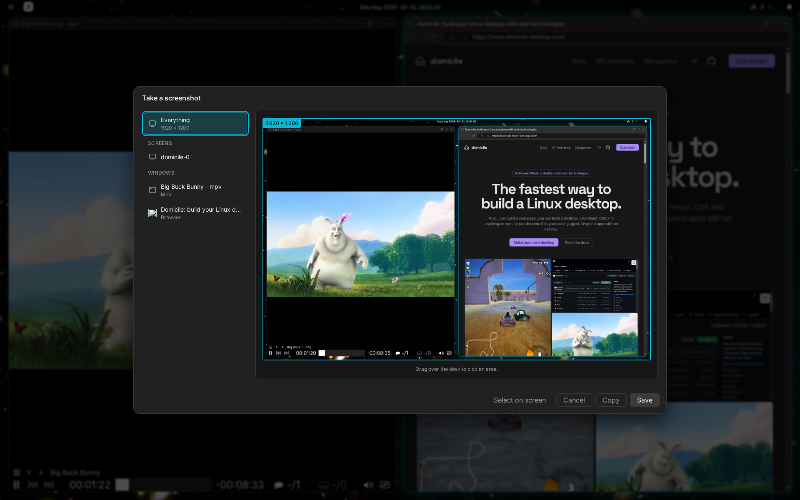

# Screenshots and recordings

## Screenshots

Press Print, or pick **Screenshot** in the launcher. Then choose a monitor, a
window, or drag out an area.

- The picture is saved in `Pictures/Screenshots`.
- Press Ctrl+C in the picker to copy it instead of saving it.
- From a terminal: `domicile screenshot`. `domicile screenshot <file>` saves
  every monitor at once, without asking.

## Recordings

Pick **Screen Record** in the launcher, or run `domicile screen-record`. Choose
a monitor, a window or an area, and it records, with its sound.

- A small toolbar pauses, resumes, stops or discards it. The toolbar is left
  out of the recording.
- The video is saved in `Videos/Screen recordings`.

## Sharing your screen

When an app or a site asks to share your screen, you pick what to share in
the same picker. While it shares, a red pill in the [top bar](TOP-BAR.md)
says so; click it to stop.

Neither works while the screen is locked.
