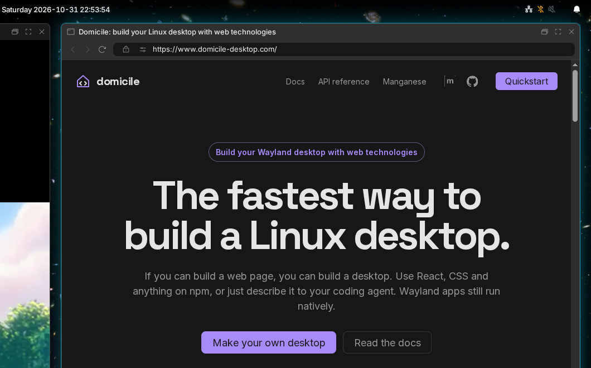

# The top bar

A clear bar across the top of each monitor.



From left to right:

- **Launcher button**: opens [the launcher](LAUNCHER.md).
- **Tray**: icons from running apps and from browser
  [extensions](BROWSER.md#extensions). Drag them to reorder. Right-click an
  app's for its menu.
- **Workspaces** on this monitor that have windows, and the one shown. Click
  one to go there.
- **Clock**, in the middle.
- **Sharing**: a red pill while an app records or shares your screen. Click
  it to see who, and stop them.
- **Cast**: while a TV is nearby. See [Casting](MONITORS.md#cast-to-a-tv).
- **Keymap**: with more than one keyboard layout. Click to switch.
- **Theme**: switches light and dark.
- **Eye**: click to keep the screens on; it opens while they are kept on.
- **Brightness**: a slider, and the night light. Scroll over it to step.
- **Volume**: scroll to step, middle-click to mute, click for the mixer:
  outputs, inputs, each app's sound and each card's profile.
- **Bluetooth**: switch it, and connect, pair or forget devices.
- **Network**: Wi-Fi networks to join, and each connection's details.
  Joining a network with a sign-in page shows that page.
- **Battery**: the level, red at 10%.
- **Bell**: [notifications](NOTIFICATIONS.md).

Items for hardware you don't have, such as a battery or Bluetooth, don't
show.

## The clock

<!-- tab: Settings app -->

Open **Settings**, then **Shell**. Pick a 12- or 24-hour clock, and whether
it shows seconds.

<!-- tab: Config file -->

```json
{ "shell_options": { "clock": { "format": "12h", "seconds": false } } }
```

<!-- /tabs -->

## Change what it shows

The bar's items are set in a [config module](CONFIGURE.md#a-config-module),
in three columns:

```tsx
import { runManganese } from "@domicile-desktop/manganese";
import { Clock } from "@domicile-desktop/manganese-bar-module-clock";
import { Tray } from "@domicile-desktop/manganese-bar-module-tray";
import { WorkspaceSwitcher } from "@domicile-desktop/manganese-bar-module-workspace-switcher";

export const Shell = runManganese({
  bar: {
    left: [<Tray key="tray" />, <WorkspaceSwitcher key="workspaces" />],
    center: [<Clock key="clock" />],
    right: [],
  },
});
```

There are also items for a Gmail inbox and Google Messages, and you can write
your own in React. The full list:
[TOP-BAR.md](../../packages/shell-manganese/docs/TOP-BAR.md).
