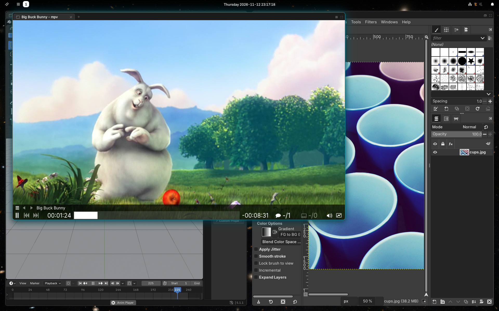

# Windows and workspaces

Windows tile in tab groups: each new one opens as a tab beside the window you
are in. Split groups to see them side by side. Apps and browser windows tile,
float and close the same way.



## Tiling

- A new window opens as a tab next to the focused one. Closing a window gives
  its space to the rest.
- **Focus follows the pointer.** The window under it gets the keyboard; a
  click raises it.
- Every window sits in a group, shown as tabs (Meta+W) or stacked (Meta+S).
  Meta+W on a group already in tabs merges it with the groups beside it.
  Meta+B or Meta+V moves the window out of its group, to the right or below,
  into a group of its own. Meta+E splits every tab of a group out side by
  side.
- Meta+Shift+arrow moves a window along its tabs, then out of its group. A
  window alone in its group joins the next group that way.
- Groups nest. Meta+G turns the tab you are in into a group of its own, so
  new windows open in it, and Meta+B or Meta+V inside it splits it within
  its tab.
- Meta+A selects the whole group, so the next key moves, floats or
  fullscreens it. Meta+Shift+arrow then moves it like a window: in as a tab
  of the next group, along its tabs, then out past the last one. A window alone in its group skips it and selects the
  windows around it.
- Drag a window by its title bar, or anywhere with Meta held, to move it. A
  highlight shows where it will land: a side of a window, or the middle to
  join its tabs. Drag the border between windows to resize them.
- Apps that draw their own title bar, such as GNOME apps and Firefox, move
  the same way when you drag theirs, and resize from their own edges.

## Title bars and tabs

Every window has a title bar with its icon, name, and buttons to float,
fullscreen and close it. In a tabbed group the title bars are the tabs.

- Middle-click a title bar or tab to close it.
- The **+** after a group's last tab opens the launcher, and what you open
  joins the group.
- Drag a tab along its strip to reorder it, or off the strip to pull it out.

## Floating

- Meta+Shift+Tab floats a window above the others, or tiles it again.
- Dialogs, and windows of a fixed size, open floating.
- Drag a floating window by its title bar, or with Meta held. Resize it from
  any edge, or with Meta+right-drag.
- **The scratchpad** keeps windows hidden until you want them: Meta+Shift+Minus
  sends one there, Meta+Minus brings it back over the screen.

To always float some app, add a rule in your
[config module](CONFIGURE.md#a-config-module):

```tsx
export const Shell = runManganese({
  floating: [{ app: "pinentry" }, { app: "^Slack$", title: "^Huddle" }],
});
```

Each rule matches the window's app id and title, as regular expressions.

## Workspaces

- There are ten, Meta+1 to Meta+0. Meta+Shift+number sends the window there.
- Each monitor shows one workspace. The bar lists the ones on its monitor
  that have windows.
- Going to a workspace another monitor shows moves you to that monitor.
- Pressing the number of the workspace you are on goes back to the last one.

## Overview

Meta+O, a four-finger pinch in, or the button left of the workspaces in the
bar shows each monitor's workspaces side by side, with their windows: the
ones that have windows, and the one shown.

- Click a workspace to go there, or a window to go to it.
- Drag a window onto another workspace to move it there.
- Arrow keys or Meta+H/J/K/L pick a workspace, on to the next monitor at
  the edge, and Enter goes there.
- Meta+Shift+H/J/K/L swaps the picked workspace with the next one that way,
  windows and all, on to the next monitor at the edge too. Each monitor
  keeps showing the same spot, so a workspace you swap off-screen is no
  longer on screen.
- Other keys, and the bar's workspace buttons, do nothing while it is
  open. Lock, screenshot, volume and brightness keys still work, and Meta+O
  and the launcher and clipboard keys still close it.
- The workspace your keys are on has a bold white ring, and the one on
  screen has a colored ring. The white ring moves with a workspace you
  swap. The workspace under the pointer gets a faint ring.
- Escape, Meta+O, a four-finger spread, or a click outside the
  workspaces closes it. The launcher and clipboard close it too.

## Fullscreen

Meta+F fills the monitor with the window, or with the group after Meta+A.
Meta+Shift+F spans every monitor. A video's own fullscreen button does the
same.

How it all works: [WINDOW-MANAGEMENT.md](../../packages/manganese-window-management/docs/WINDOW-MANAGEMENT.md).
