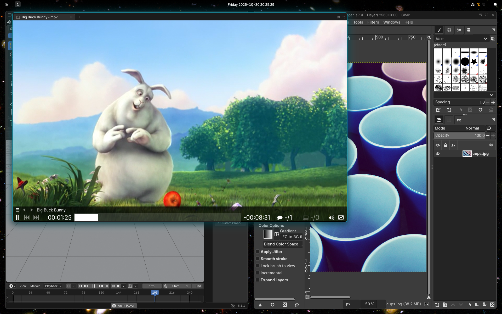

# Windows and workspaces

Windows tile: each new one takes a share of the screen, beside the window you
are in. Apps and browser windows tile, float and close the same way.



## Tiling

- A new window opens next to the focused one. Closing a window gives its
  space to the rest.
- **Focus follows the pointer.** The window under it gets the keyboard; a
  click raises it.
- Windows sit in groups. A group lays its windows out side by side, in tabs
  (Meta+W) or stacked (Meta+S). Meta+B or Meta+V before opening a window puts
  it beside or below.
- Meta+A selects the whole group, so the next key moves, floats or
  fullscreens it.
- Drag a window by its title bar, or anywhere with Meta held, to move it. A
  highlight shows where it will land: a side of a window, or the middle to
  join its tabs. Drag the border between windows to resize them.

## Title bars and tabs

Every window has a title bar with its icon, name, and buttons to float,
fullscreen and close it. In a tabbed group the title bars are the tabs.

- Middle-click a title bar or tab to close it.
- The **+** after a group's last tab opens the launcher, and what you open
  joins the group.
- Drag a tab along its strip to reorder it, or off the strip to pull it out.

## Floating

- Meta+Shift+Tab floats a window above the others, or tiles it again.
- Dialogs, and windows of a fixed size, open floating.
- Drag a floating window by its title bar, or with Meta held. Resize it from
  any edge, or with Meta+right-drag.
- **The scratchpad** keeps windows hidden until you want them: Meta+Shift+Minus
  sends one there, Meta+Minus brings it back over the screen.

To always float some app, add a rule in your
[config module](CONFIGURE.md#a-config-module):

```tsx
export const Shell = runManganese({
  floating: [{ app: "pinentry" }, { app: "^Slack$", title: "^Huddle" }],
});
```

Each rule matches the window's app id and title, as regular expressions.

## Workspaces

- There are ten, Meta+1 to Meta+0. Meta+Shift+number sends the window there.
- Each monitor shows one workspace. The bar lists the ones on its monitor
  that have windows.
- Going to a workspace another monitor shows moves you to that monitor.
- Pressing the number of the workspace you are on goes back to the last one.

## Fullscreen

Meta+F fills the monitor with the window, or with the group after Meta+A.
Meta+Shift+F spans every monitor. A video's own fullscreen button does the
same.

How it all works: [WINDOW-MANAGEMENT.md](../../packages/manganese-window-management/docs/WINDOW-MANAGEMENT.md).
